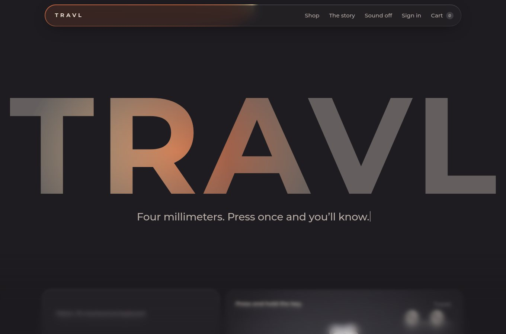
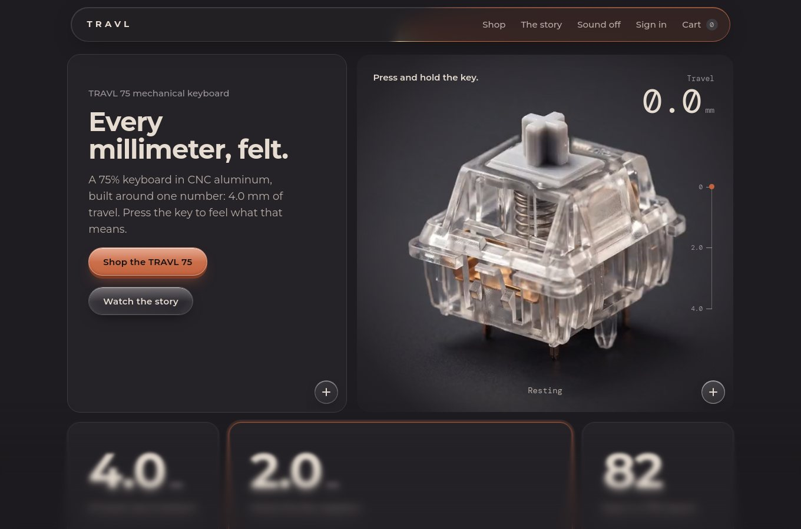
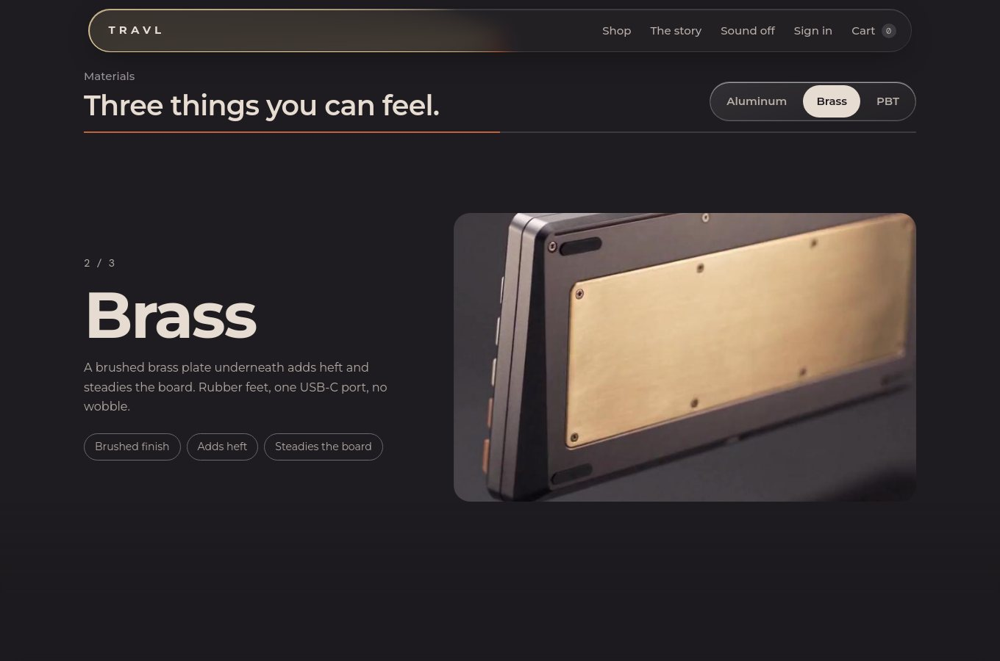
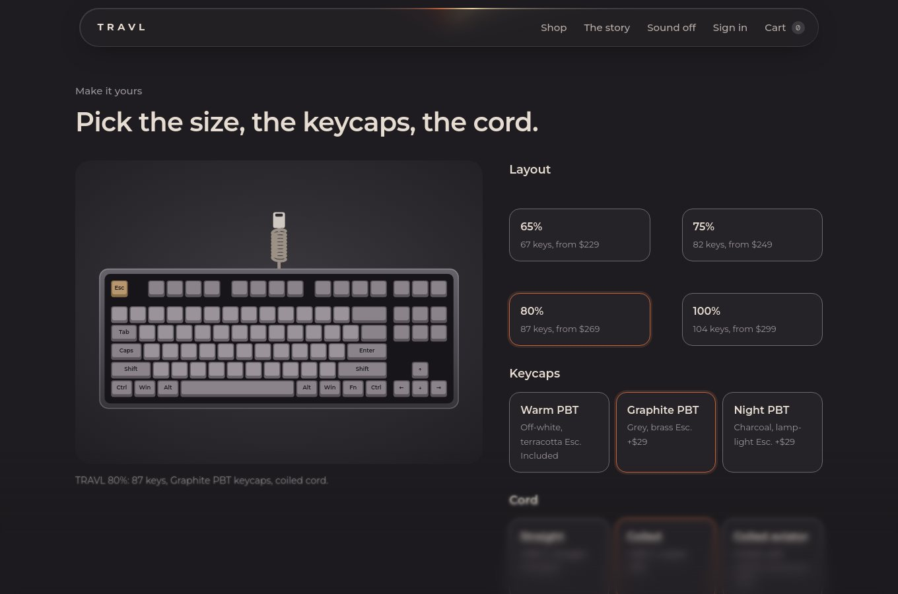
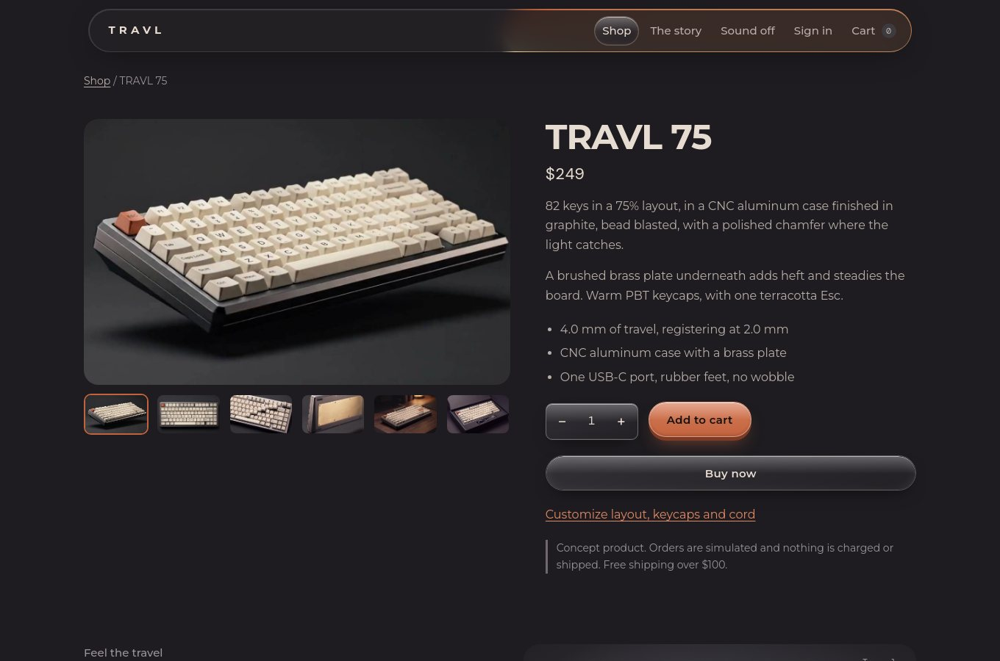
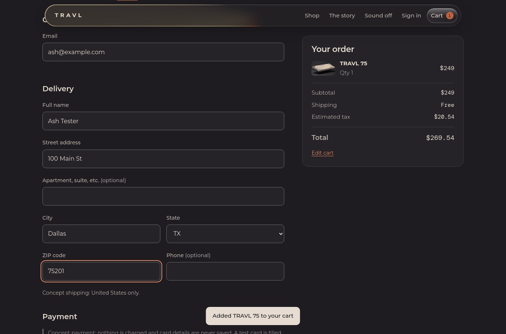
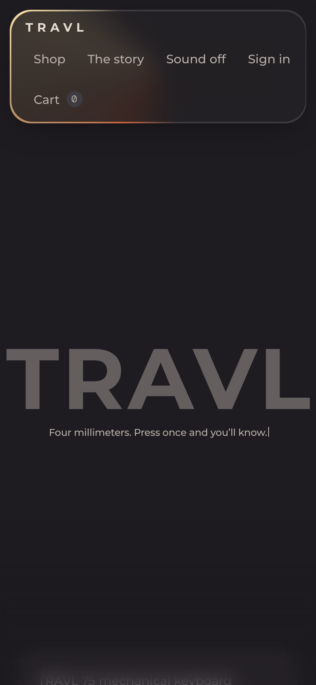

# TRAVL

**A concept storefront for a 75% mechanical keyboard, built around one number: 4.0 mm of travel.**
Vanilla HTML, CSS and JavaScript. No framework, no bundler, 65 browser tests, plus a Python test suite for the asset pipeline.

[Live demo](https://overseerdotpy.github.io/travl-store/) · [Scroll story](https://overseerdotpy.github.io/travl-store/story/) · [Case study](https://overseerdotpy.github.io/travl-store/case-study/)



> TRAVL is a fictional brand and a design and front-end exercise. Nothing is charged, built or shipped, and the "backend" is the browser (see [Honest limits](#honest-limits)).

## What it does

- **Brand-name hero.** The wordmark rests at 35% opacity (65% transparent), rises in letter by letter, sweeps once with light, then follows the cursor. The subline types itself and stays on one line at every width.
- **Press the key.** Hold the switch and a video scrubs frame by frame while a counter reads real millimeters. At 2.0 mm it registers (with an optional synthesized click), at 4.0 mm it bottoms out.
- **Expandable bento grid.** Panels grow on hover or via a `+` toggle (touch and keyboard). It is regression-tested against a real hover-glitch bug, see [`docs/DECISIONS.md`](docs/DECISIONS.md#4-the-bento-grid-hover-from-resting-geometry-constant-width-content-locked-rows).
- **Pinned horizontal materials section.** Vertical scroll slides Aluminum, then Brass, then PBT, with clickable tabs. Reduced-motion visitors get a plain stacked layout.
- **Product configurator.** Layout (65%, 75%, 80%, 100%), keycaps and cord, with a live SVG drawing generated from real key layouts (67, 82, 87 and 104 keys) and a price that adds up. Configured boards go through the real cart and checkout.
- **Cart, checkout, accounts.** Specific validation messages linked to each field, Luhn and expiry checks on the (test) card, salted password hashing, order history, "delete my data".
- **Liquid-glass buttons, ripple, progressive blur, typing animation.** Every effect respects `prefers-reduced-motion`.

| | |
| --- | --- |
|  |  |
|  |  |
|  |  |

## Quick start

Requires Node 20 or newer.

```bash
npm install
npm start          # builds, then serves dist/ at http://localhost:4173
```

### Tests

```bash
npx playwright install chrome   # once: the hero clip is H.264, which Playwright's bundled Chromium can't decode
npm test                        # builds, then runs all 65 tests
npm run report                  # open the HTML report
```

Already have a Chrome or Chromium with H.264? Skip the install and run `CHROME_PATH=/path/to/chrome npm test`.

Python tests for the wordmark generator (Python 3.10 or newer):

```bash
pip install -r tools/requirements.txt
npm i --no-save @fontsource/montserrat   # the font the generator reads
pytest
```

## Project structure

```
src/
  index.html          HTML shell and head metadata (the build fills in the placeholders)
  styles.css          all styles, with theme tokens for dark and light
  js/                 sections of one scope, concatenated in filename order
    00-core-effects   helpers, typing, ripple, progressive blur, bento hover model
    10-materials      pinned horizontal scroll
    20-configurator   key layouts, SVG drawing, options and pricing
    30-catalog        products
    40-storage        localStorage state (plus an optional remote mirror)
    50-sound          synthesized key click
    60-switch         video scrubbed by travel
    70-cart … 93-events   cart math, forms, views, router, events
assets/               images, the press clip, the wordmark outlines (see ASSETS.md)
scripts/              build.mjs (no dependencies), lighthouse.mjs
tests/                Playwright specs
tests_py/             pytest suite for the wordmark generator and wordmark.json
tools/                make_wordmark.py (how the wordmark outlines were generated)
docs/                 DECISIONS.md and screenshots
.github/workflows/    CI, informational Lighthouse run, GitHub Pages deploy
```

## Testing

65 Playwright tests, run in real Chrome:

| Spec | What it proves |
| --- | --- |
| `home` | wordmark opacity and cursor glow, one-line subline at six widths, typing, press-and-hold scrubs the video, ripple, reduced motion, typed text never outgrows its reserved space, metadata |
| `shop` | cart math and tax, checkout validation, card checks, orders, accounts (hash never stored in the clear, wrong password rejected, persistence) |
| `configurator` | key counts and prices for every layout, cord drawing, keyboard operation, configured boards survive reload and checkout |
| `materials` | the pin, the slide positions, tabs, the pin releasing |
| `bento` | content never moves on hover, rows never change height, no flip-flop at panel edges, one switch per boundary crossing, no clipped text at three widths, touch toggle |
| `responsive` | no horizontal overflow on a phone, on every route |
| `a11y` | axe-core (WCAG 2.0/2.1 A and AA) on six routes in dark and light |

The bento tests were checked against the pre-fix build: they fail there with the measured numbers (content moved 20.3 px, row heights `[250, 259]`) and pass now.

### Python: the wordmark pipeline

The hero wordmark is generated, not drawn: `tools/make_wordmark.py` shapes "TRAVL" with HarfBuzz from real Montserrat Bold outlines and writes SVG paths to `assets/wordmark.json`. A pytest suite (`tests_py/`) guards both halves:

| Group | What it proves |
| --- | --- |
| The committed JSON (no dependencies) | exactly the keys the page reads; viewBox matches width and height; one well-formed path per letter; every point inside the viewBox; ink touches all four edges (no stray margin); letters run left to right |
| The generator (needs the font) | regenerating reproduces the committed geometry; HarfBuzz kerning tightens the A-V pair; tracking adds the same space after every letter; the y axis is flipped into SVG space; text with no ink is rejected; the CLI writes the file |

The suite was checked by breaking the generator on purpose (removing the y flip, turning kerning off, hand-editing the JSON): each break fails at least one test.

## Measured quality

Measured locally with Lighthouse 13.5 in headless Chrome 131 (simulated throttling), against `dist/index.html`:

| | Performance | Accessibility | Best practices | SEO |
| --- | --- | --- | --- | --- |
| Desktop | 87 | 100 | 96 | 100 |
| Mobile | **57** | 100 | 96 | 100 |

- Layout shift is 0. (It was 0.66 before the footer was held below the fold until first render, see [`docs/DECISIONS.md`](docs/DECISIONS.md#7-layout-shift).)
- **Mobile is slow, and I know why:** the page is a single 1.5 MB file, so on a simulated slow connection first and largest contentful paint is about 9 s. Desktop is 1.6 s. This is the top item on the roadmap.
- The 96 for best practices comes from one console error: Google Fonts couldn't load in my offline test environment. I haven't measured it online.
- **axe-core found no violations** in 12 scans. axe can't judge text contrast over gradients, glass and photos, so those are reported as "needs review" (it also can't verify the `−` and `+` quantity buttons' labels). I checked the palette's text colors by hand; the glass buttons and text over photos still deserve a manual look.

## Honest limits

- **It's a concept.** Prices, product details and the option list are placeholders I made up.
- **There's no server.** Accounts, carts and orders live in `localStorage`. Passwords are salted SHA-256 hashes computed in the browser: good enough to avoid storing plain text, **not** real authentication.
- **Payments are simulated.** A test card is prefilled and card data is never saved. Don't type a real card number into any demo.
- `src/js/40-storage.js` has an optional mirror to a remote store that is only active inside Claude's artifact runtime. It does nothing on GitHub Pages.
- Fonts come from Google Fonts at runtime.

## Roadmap

1. **Performance.** Multi-file build, lazy-load the clip and below-the-fold images, self-host the fonts. Goal: mobile LCP under 2.5 s.
2. **A real backend.** Auth (Supabase or similar) and Stripe in test mode, replacing the simulated checkout.
3. **ES modules** instead of one concatenated scope, and a component library extracted from the buttons, panels and form fields.
4. Manual contrast review of the glass buttons and text over photography.

## Deploying to GitHub Pages

1. Push to a repository named `travl` on the `main` branch.
2. In **Settings, Pages**, set **Source** to **GitHub Actions**.
3. The workflow in `.github/workflows/ci.yml` builds, tests, then deploys `dist/`. A failing test blocks the deploy.

## License

Code: MIT (see `LICENSE`). Media: not licensed for reuse, see [`ASSETS.md`](ASSETS.md).
